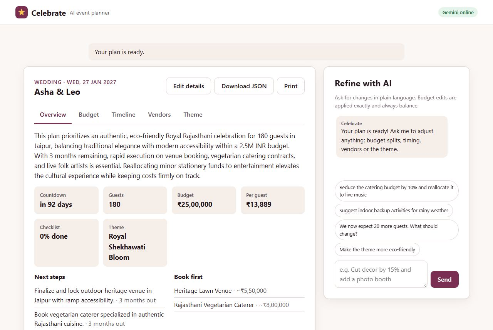
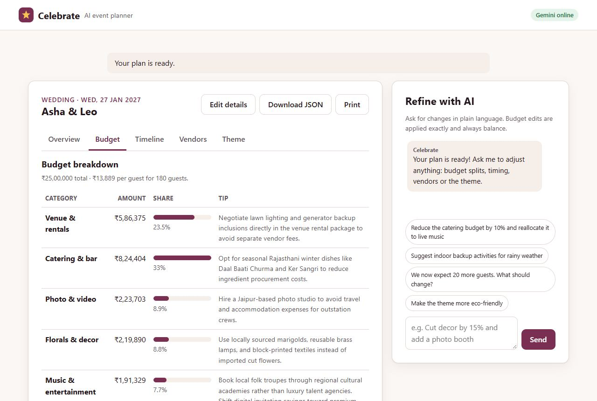
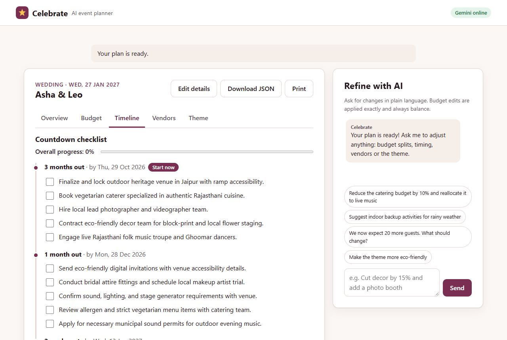
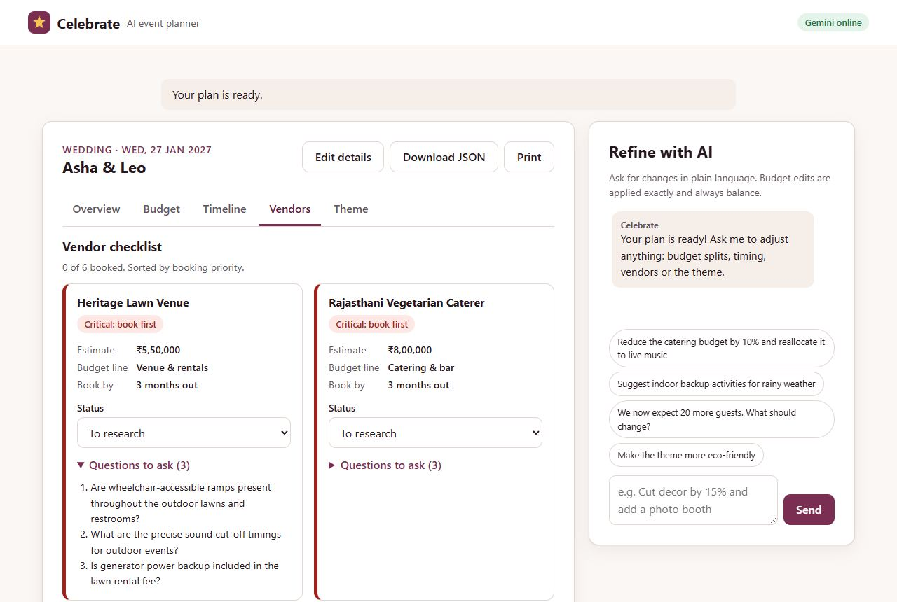
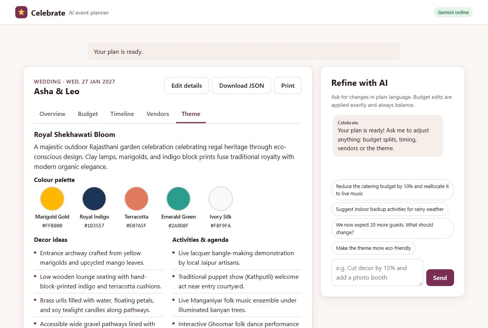
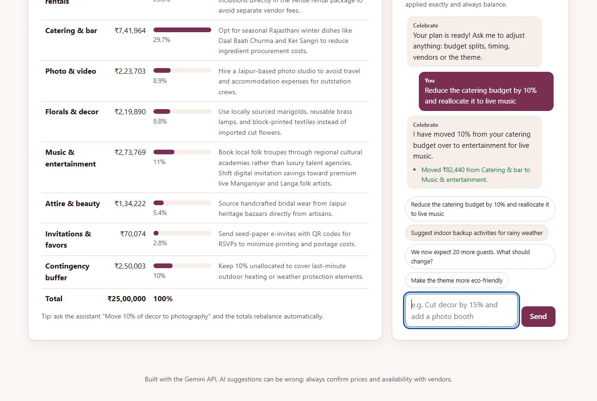
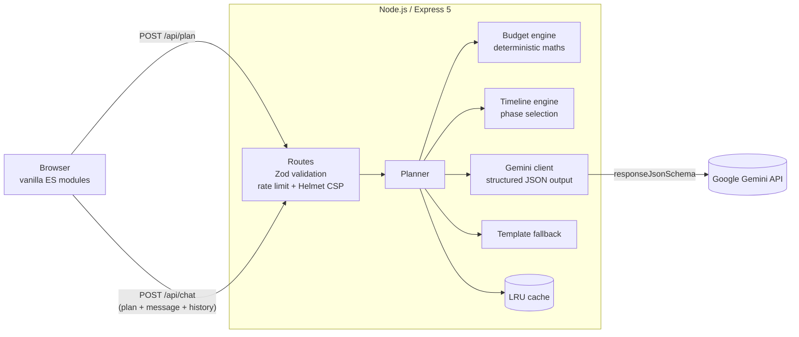

# 🎉 Celebrate: AI Event Planner

A Generative-AI planning assistant for **weddings, birthdays and community events**, built for Google PromptWars Challenge 5.
You enter the event type, budget, date, guest count and preferences. **Google Gemini** then drafts an end-to-end plan, which you can refine by chatting with it.

| Requirement | How Celebrate delivers it |
| --- | --- |
| **Intelligent budget breakdown** | Category allocation per event type, scaled by guest count and lead time (rush events reserve a larger buffer). Gemini shifts money toward stated priorities and adds a spending tip for each category. Per-guest spend is checked and warnings are raised. |
| **Timelines & milestones** | Countdown phases (12 months, 6 months, 3 months, 1 month, 2 weeks, week of, day of) are chosen from the real lead time. Each phase has a target date and a sequenced checklist with tickable tasks and a progress bar. There is also a time-stamped day-of run sheet, and every milestone can be exported to Google Calendar, Outlook or Apple Calendar as an `.ics` file. |
| **Vendor management** | A tailored vendor list (caterers, florists, AV/DJ, permits and more) with booking priority, cost estimate tied to a budget line, a "book by" phase, a status tracker (to research, contacted, quoted, booked) and 3–5 must-ask vetting questions per vendor. |
| **Themes & creative concepts** | A theme name and concept, a colour palette (swatches with hex codes), decor ideas, activities and agenda, menu ideas, and ready-to-copy invitation wording. |
| **Conversational iteration** | A chat panel accepts requests like *"Reduce catering by 10% and reallocate it to live music"* or *"Suggest indoor backup activities for rainy weather"*. Each change is applied to the plan, and every reply lists exactly what changed. |

[](../../actions/workflows/ci.yml)
· 133 tests · 99.7% line / 90.6% branch coverage · 0 TypeScript errors · 0 axe-core WCAG 2.2 AA violations · 0 npm audit vulnerabilities

## Screenshots

These are real Gemini (`gemini-3.6-flash`) output for a 180-guest outdoor wedding in Jaipur with a ₹25,00,000 budget.

| Overview | Budget breakdown |
| --- | --- |
|  |  |
| **Countdown timeline** | **Vendor checklist** |
|  |  |
| **Theme & creative concept** | **Chat refinement** |
|  |  |

---

## Architecture



**Key design decision: the AI decides, the code calculates.** LLMs are good at judgement and creativity but unreliable at arithmetic. So:

1. The **budget engine** ([src/services/budget.js](src/services/budget.js)) computes a baseline split. It uses per-event category weights scaled by guest count: `perGuest` categories such as food grow with headcount, `semi` categories such as the venue grow slowly, and `fixed` categories such as the photographer don't grow. It also holds back a contingency reserve.
2. **Gemini** receives that baseline and returns *intent*. For example, it might return `{"type":"move","from":"catering","to":"Live music","percent":10}`, along with tasks, vendors and theme content.
3. The engine applies those operations, so **every plan always sums exactly to the user's total**. Moves are clamped, new categories are created on demand, and totals and percentages are re-derived on every change.
4. Gemini runs with **structured output** (`responseMimeType: application/json` plus `responseJsonSchema`). Enums are built per request from the real category and phase ids, and the result is validated again with Zod. Over-long strings are truncated, invalid colours and times are dropped, and unknown enum values fall back to safe defaults.
5. If Gemini is unavailable (no key, quota, timeout or malformed output), the planner **falls back** to curated template content and a rule-based chat parser. The app never shows a 500 because of the AI.

### Project structure

```
server.js                 Entry point (wires config → Gemini client → planner → app)
src/
  app.js                  Express app: Helmet CSP, compression, rate limit, static files, error handler
  config.js               Env-driven, frozen configuration
  constants.js            Shared vocabulary (event types, currencies, limits)
  validation.js           Zod schemas: strict request schemas + lenient AI-output schemas
  routes/api.js           GET /api/health · POST /api/plan · POST /api/chat
  services/
    planner.js            Orchestrates generation & refinement, merges AI output into plans
    budget.js             Deterministic allocation + budget operations (move / set_total / set_guest_count)
    timeline.js           Lead-time aware countdown phases with target dates
    gemini.js             @google/genai wrapper returning parsed JSON (timeout via AbortSignal)
    geminiSchemas.js      Per-request JSON Schemas for structured output
    prompts.js            System + user prompt templates
    fallback.js           Offline template content and rule-based chat
    cache.js              In-memory LRU + TTL cache for identical requests
  logger.js               Structured JSON logs (never includes user content)
  types.js                Shared JSDoc types (Plan, Budget, Vendor…) checked by TypeScript
public/
  index.html              Semantic, accessible single page
  css/styles.css          Responsive light/dark theme, print stylesheet
  js/                     main (entry) · controller (state & events, dependency-injected) · render (DOM)
                          api · storage · format · ics (calendar export) · dom
tests/                    133 tests: node:test, supertest, jsdom + axe-core (99.7% line coverage)
docs/screenshots/         README screenshots (real Gemini output)
.github/workflows/ci.yml  Lint, tests with coverage gates and npm audit on Node 22 and 24
```

---

## Prompts

Prompts live in [src/services/prompts.js](src/services/prompts.js). Both system prompts share these guardrails:

- Text inside `<event_details>`, `<current_plan>`, `<conversation>` and `<user_message>` is **untrusted data**. User text is embedded with `JSON.stringify`, so it cannot close a tag or inject instructions.
- The assistant stays on topic and politely declines anything unrelated to event planning.
- Costs are whole numbers in the plan currency and must be realistic for the location and scale.
- The assistant respects dietary, cultural, accessibility and sustainability preferences.

**Plan generation** (`PLAN_SYSTEM_PROMPT` + `buildPlanPrompt`), temperature 0.8. The model receives:
- the event brief
- today's date and the number of days until the event
- the engine's baseline allocation
- the exact phase ids to fill, with their target dates

It returns: summary · `allocationShifts` (0–3, capped at 20% each, never from contingency) · `categoryNotes` · tasks per phase · day-of schedule · 6–10 vendors with vetting questions · theme.

**Chat refinement** (`CHAT_SYSTEM_PROMPT` + `buildChatPrompt`), temperature 0.5. The model receives:
- a *compact* projection of the plan, to save tokens
- the last 8 turns of conversation
- the new message
- the valid category and phase ids

It returns `reply` plus only the changes needed: `budgetOperations`, `addTasks`, `addVendors`, `addActivities`, and optionally `theme` or `dayOf`. A worked example inside the prompt teaches the model to express budget edits as operations rather than numbers.

---

## Run locally

Requires **Node.js 22+**.

```bash
git clone <this-repo-url> && cd celebrate-ai-event-planner
npm install
cp .env.example .env          # then paste your key into GEMINI_API_KEY
npm start                     # http://localhost:8080
```

Get a free Gemini API key at <https://aistudio.google.com/apikey>. Without a key the app still runs in **template mode**: plans come from curated defaults, and the chat understands simple budget moves and rain-plan requests.

| Variable | Default | Purpose |
| --- | --- | --- |
| `GEMINI_API_KEY` | — | Enables AI features (kept server-side only) |
| `GEMINI_MODEL` | `gemini-3.6-flash` | Any Gemini model that supports structured output |
| `AI_TIMEOUT_MS` | `75000` | Abort slow Gemini calls (then fall back to templates) |
| `AI_THINKING_LEVEL` | `LOW` | Gemini thinking depth: `MINIMAL`, `LOW`, `MEDIUM`, `HIGH`, or empty to use the model default |
| `RATE_LIMIT_PER_MINUTE` | `20` | Per-IP limit on `/api/plan` and `/api/chat` |
| `PLAN_CACHE_TTL_MS` | `600000` | Cache lifetime for identical plan requests |
| `TRUST_PROXY` | `1` | Proxy hops (correct client IPs behind Render or Cloud Run) |

### Scripts

```bash
npm test               # 133 unit, integration, UI-flow and accessibility tests
npm run test:coverage  # coverage report, fails below 95% lines / 85% branches / 95% functions
npm run lint           # ESLint (flat config)
npm run audit          # npm audit of production dependencies
npm run typecheck      # TypeScript checkJs over server and browser code (JSDoc types)
npm run check          # everything CI runs: lint + typecheck + coverage gates + audit
npm run dev            # auto-restart on changes
```

---

## Deploy

**Render (free):** push to GitHub, then go to Render → *New + → Blueprint* and pick the repo. [render.yaml](render.yaml) configures everything. Set `GEMINI_API_KEY` when prompted.

**Google Cloud Run:**

```bash
gcloud run deploy celebrate --source . --region asia-south1 --allow-unauthenticated \
  --set-env-vars GEMINI_API_KEY=YOUR_KEY,NODE_ENV=production
```

The [Dockerfile](Dockerfile) builds a small `node:22-alpine` image that runs as the non-root `node` user.

---

## Quality notes

### Security
- The API key never leaves the server.
- Helmet sets a strict CSP (`script-src 'self'`, no inline scripts or styles, `frame-ancestors 'none'`), `nosniff`, HSTS and more.
- `/api/plan` and `/api/chat` are rate-limited per IP.
- The JSON body limit is 100 kB.
- Strict Zod schemas reject unknown fields, oversized text and invalid dates or colours, and strip control characters.
- Client-supplied plans are re-validated and their totals recomputed server-side.
- Prompt-injection mitigations are described under [Prompts](#prompts).
- The UI renders all AI text with `textContent` and never uses `innerHTML`, so it is XSS-safe by construction.
- Error responses never leak internal details.
- A restrictive `Permissions-Policy` denies camera, microphone, location and payment APIs.
- `npm audit` runs in CI, and the Docker image runs as a non-root user.

- Every API response carries an `X-Request-Id`, and requests are logged as structured JSON (method, path, status, duration), never with user content.
- POSTs must be `application/json` (anything else gets a 415), which also blocks cross-site form submissions.

See [SECURITY.md](SECURITY.md) for the full threat model.

### Efficiency
- The frontend has no framework, no build step and no external requests, and assets are compressed.
- JS modules are preloaded with `modulepreload`, so the browser fetches them in parallel.
- Gemini runs with a LOW thinking level, which brings a full plan from about 70 s down to about 20 s.
- Transient Gemini errors (503 or 429) get one retry within the same deadline.
- Identical concurrent plan requests are merged into a single Gemini call, and each caller gets its own copy.
- Template fallbacks are never cached, so the next request tries Gemini again.
- Identical plan requests are served from an LRU cache.
- Chat sends a compact plan projection to Gemini instead of the full plan.
- One structured-output call replaces several separate prompt calls.
- The server is stateless (the plan round-trips with the client), so it scales horizontally.

### Testing
133 tests run with Node's built-in runner. CI ([.github/workflows/ci.yml](.github/workflows/ci.yml)) runs lint, the TypeScript check, the tests and `npm audit` on Node 22 and 24, and fails if coverage drops below its thresholds. Server code and browser code are both measured.

| File | What it covers |
| --- | --- |
| [budget.test.js](tests/budget.test.js) | Allocation sums exactly for every event type, budget and guest count; scaling; rush buffer; warnings; every budget operation; immutability |
| [timeline.test.js](tests/timeline.test.js) | Phase selection by lead time, target dates, date parsing |
| [validation.test.js](tests/validation.test.js) | 11 invalid-input cases, text cleaning, AI-output sanitising (bad colours and times, truncation, enum fallbacks) |
| [planner.test.js](tests/planner.test.js) | A fake Gemini client: success, errors, malformed JSON, fallback, caching, capped shifts, chat edits, unrequested theme changes ignored, prompt-injection encoding |
| [gemini.test.js](tests/gemini.test.js) | Structured-output request config, thinking level, retry on 503/429, no retry on permanent errors |
| [api.test.js](tests/api.test.js) | HTTP status codes (201, 400, 404, 413, 429, 500), security headers, no leaking of secrets or internals, tampered plans rejected |
| [ui.test.js](tests/ui.test.js) | The real `index.html` and rendered plan audited with **axe-core** (0 violations), XSS payloads rendered as text, labels, tab wiring, event handlers |
| [controller.test.js](tests/controller.test.js) | The full browser flow in jsdom: validation and focus, progress messages, busy states, generating and saving, the fallback warning, server errors, chat (Enter vs Shift+Enter, chips, failures), arrow, Home and End keys on tabs, ticking tasks with focus kept, vendor status, copy, JSON and calendar downloads, session restore |
| [client.test.js](tests/client.test.js) | The browser fetch wrapper (errors, timeouts, non-JSON responses), storage when blocked or corrupt, the `.ics` builder (escaping, line folding, dates) |
| [support.test.js](tests/support.test.js) | Cache TTL and LRU, offline chat parser, frontend formatting and validation helpers |

### Accessibility
The UI targets WCAG 2.1 AA:
- skip link, landmark regions and a logical heading order
- every input labelled, with field errors linked via `aria-describedby` and `aria-invalid`
- an `aria-live` status region, and a chat log with `role="log"`
- the WAI-ARIA tabs pattern with arrow, Home and End keys
- visible focus rings and 44px touch targets
- colours that aren't the only signal (amounts and percentages are always shown as text)
- `prefers-color-scheme` dark mode, `prefers-reduced-motion`, and a print stylesheet

How it is verified:
- [tests/ui.test.js](tests/ui.test.js) runs axe-core on every build.
- A full axe audit in headless Chrome against WCAG 2.2 AA, including colour contrast, found 0 violations across the form, all five tabs and the chat, in both light and dark mode.
- [tests/controller.test.js](tests/controller.test.js) checks keyboard behaviour and focus management (first invalid field, results heading, chat input, the checkbox you just ticked).
- Windows High Contrast (`forced-colors`) mode keeps the selected tab, chosen options and budget bars visible.
- Progress messages are announced politely while Gemini works, and busy regions use `aria-busy`.

## Responsible AI

AI estimates are guidance only. Every plan is labelled as coming from Gemini or from templates. If Gemini is enabled but a plan falls back to templates, a visible alert says so. The footer reminds users to confirm prices and availability with vendors.

## License

[MIT](LICENSE)
